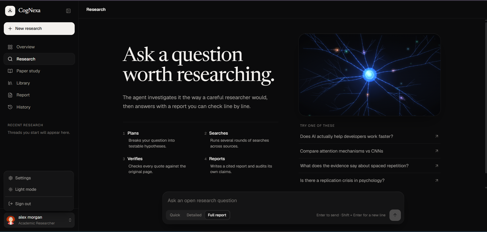
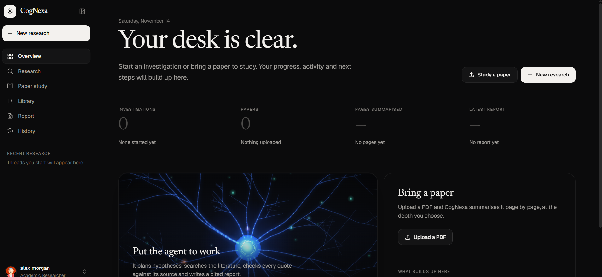
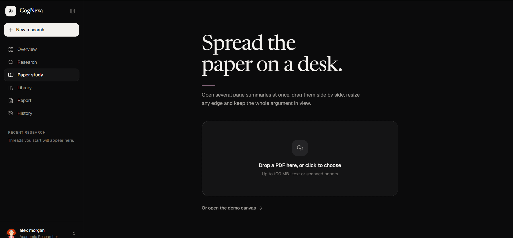
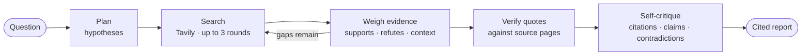

<div align="center">

# CogNexa

**An autonomous research agent that investigates open questions, verifies every quote against its source, and studies academic papers page by page.**

[Live demo](https://autonomous-research-agent-nu.vercel.app) · [Features](#features) · [How it works](#how-the-research-agent-works) · [Getting started](#getting-started) · [API](#api-reference)


<br />



</div>

---

## Overview

Most AI answers can't be checked. CogNexa is built the other way round: it researches a question the way a careful researcher would, then hands back a report where every claim points to a quoted source you can open and verify.

It has two modes:

- **Research mode.** Ask an open question. The agent breaks it into testable hypotheses, searches across several rounds, weighs supporting and refuting evidence, verifies quotes against the original pages, critiques its own draft, and writes a cited report.
- **Paper study.** Upload a PDF and CogNexa summarises it page by page at the depth you choose, then lets you spread several page summaries side by side on a draggable canvas.

## Screenshots

<table>
  <tr>
    <td width="50%">
      
      <p align="center"><b>Research overview</b><br /><sub>Progress, activity and next steps, built only from your real data</sub></p>
    </td>
    <td width="50%">
      
      <p align="center"><b>Paper study</b><br /><sub>Upload a PDF and read it page by page on a canvas</sub></p>
    </td>
  </tr>
</table>

## Features

### Research agent
- **Hypothesis-driven investigation.** Questions are decomposed into testable hypotheses, each judged *supported*, *refuted* or *mixed*.
- **Multi-round search.** Up to three rounds of web search via Tavily, refining queries between rounds.
- **Quote verification.** Every piece of evidence is checked against the original source page, and each quote is labelled verified, snippet-only or unverified.
- **Contradiction detection.** Conflicting evidence is surfaced rather than averaged away.
- **Self-critique.** The agent audits its own report: citations must resolve and claims must not exceed their evidence.
- **Three depths.** Quick answer, detailed explanation or full cited report.
- **Deep-linked citations.** Inline `[E#]` citations open the source with the quoted passage highlighted, using text fragments.

### Paper study
- PDF upload with text extraction (PyMuPDF).
- Page-by-page summaries at **Beginner**, **Medium** or **Pro** level, generated in the background, with live progress over Server-Sent Events.
- On-demand regeneration of any page.
- A canvas workspace for laying out several page summaries side by side, with drag, resize and arrange.

### Workspace
- **Research overview:** reading coverage, hypothesis verdicts, an activity timeline and suggested next steps, all derived from your data and never invented.
- **Report view:** the agent's run timeline, hypothesis verdicts, and an evidence panel filterable by supporting, refuting and verified sources.
- **History and library:** every session and paper, with page-level progress.
- Light and dark themes, a collapsible sidebar, and a responsive layout down to phone width.

## How the research agent works



Each run returns a structured result: the hypotheses with their verdicts, a full evidence log (source, stance, confidence, quote, verification status), the self-critique checks, and run statistics (duration, model calls, searches). The frontend renders this as a report rather than a chat message.

## Tech stack

| Layer | Technology |
| --- | --- |
| Frontend | Next.js 14 (App Router), React 18, TypeScript |
| Styling | Tailwind CSS, Radix UI primitives, Lucide icons |
| Data and state | TanStack Query, Zustand |
| Backend | FastAPI, Uvicorn, Pydantic |
| AI and search | Google Gemini (`google-genai`), Tavily search |
| Documents | PyMuPDF for PDF text extraction |
| Database | SQLAlchemy with Alembic migrations (SQLite by default, any SQLAlchemy URL via `DATABASE_URL`) |
| Hosting | Vercel (frontend), Render (backend) |

## Project structure

```
.
├── backend/
│   ├── app/
│   │   ├── main.py        # FastAPI app, research routes, CORS
│   │   ├── research.py    # Research agent: hypotheses, search rounds, verification, critique
│   │   ├── papers.py      # Paper upload, page summaries, SSE progress
│   │   ├── llm.py         # Gemini client with model fallback
│   │   ├── search.py      # Tavily search
│   │   ├── tasks.py       # Background summary generation
│   │   ├── models.py      # SQLAlchemy models
│   │   └── database.py    # Engine and session
│   ├── alembic/           # Database migrations
│   └── requirements.txt
├── frontend/
│   ├── app/               # Routes: dashboard, research, paper-study, library, report, history, settings
│   ├── components/        # UI, research views, neural animation, layout
│   └── lib/               # API client, queries, store, response adapters
├── docs/screenshots/
└── render.yaml            # Render deployment blueprint
```

## Getting started

### Prerequisites
- Node.js 18.17 or later
- Python 3 with `pip`
- A [Google Gemini API key](https://aistudio.google.com/apikey) and a [Tavily API key](https://tavily.com)

### 1. Backend

```bash
cd backend
python -m venv venv
# Windows: venv\Scripts\activate    macOS/Linux: source venv/bin/activate
pip install -r requirements.txt
cp .env.example .env               # then add your API keys
uvicorn app.main:app --reload --port 8000
```

The API is now at `http://localhost:8000`. Tables are created automatically on first start.

### 2. Frontend

```bash
cd frontend
npm install
echo NEXT_PUBLIC_API_URL=http://localhost:8000 > .env.local
npm run dev
```

Open [http://localhost:3000](http://localhost:3000). Run the frontend on port 3000: the backend's default CORS settings allow that origin.

### Environment variables

**Backend (`backend/.env`)**

| Variable | Required | Description |
| --- | --- | --- |
| `GEMINI_API_KEY` | Yes | Google Gemini API key |
| `TAVILY_API_KEY` | Yes | Tavily search API key |
| `GEMINI_MODEL` | No | Override the primary Gemini model (fallback models are tried automatically) |
| `DATABASE_URL` | No | SQLAlchemy database URL; defaults to a local SQLite file |
| `ALLOWED_ORIGINS` | No | Comma-separated CORS origins; defaults to `http://localhost:3000,http://127.0.0.1:3000` |
| `LLM_MOCK` | No | Set to `1` for local UI development without calling the model |

**Frontend (`frontend/.env.local`)**

| Variable | Description |
| --- | --- |
| `NEXT_PUBLIC_API_URL` | Base URL of the backend API |

## API reference

| Method | Endpoint | Description |
| --- | --- | --- |
| `GET` | `/health` | Health check |
| `POST` | `/research` | Run the research agent. Body: `{ "question": string, "output_format": "quick" \| "detailed" \| "full" }` |
| `GET` | `/research/sessions` | List research sessions |
| `GET` | `/research/sessions/{id}` | Full session: hypotheses, evidence log, report, critique, stats |
| `GET` | `/research/latest-report` | Latest report as findings, sources and citations |
| `GET` | `/search?query=` | Direct web search |
| `GET` | `/papers` | List uploaded papers |
| `POST` | `/papers` | Upload a PDF (multipart: `file`, `level`) |
| `GET` | `/papers/{id}` | Paper details |
| `PATCH` | `/papers/{id}` | Change the summary level |
| `GET` | `/papers/{id}/file` | Download the original PDF |
| `GET` | `/papers/{id}/pages` | Summary status for every page |
| `GET` | `/papers/{id}/pages/{n}` | One page summary (generated on demand) |
| `POST` | `/papers/{id}/pages/{n}/regenerate` | Regenerate a page summary |
| `GET` | `/papers/{id}/progress` | Summary progress as Server-Sent Events |

Questions shorter than 10 characters are rejected with `400`.

## Deployment

- **Backend → Render.** `render.yaml` defines the web service (`uvicorn app.main:app`). Set `GEMINI_API_KEY` and `TAVILY_API_KEY` in the Render dashboard, and set `ALLOWED_ORIGINS` to your frontend URL.
- **Frontend → Vercel.** Import the repository with `frontend` as the root directory and set `NEXT_PUBLIC_API_URL` to the Render service URL. The backend also accepts any `*.vercel.app` preview origin.

> On Render's free tier the service sleeps when idle, and the default SQLite database does not persist across redeploys. Set `DATABASE_URL` to a managed database to keep sessions and papers.

## Author

Built by **[Stuti Thakker](https://github.com/thakkerstuti)**.
