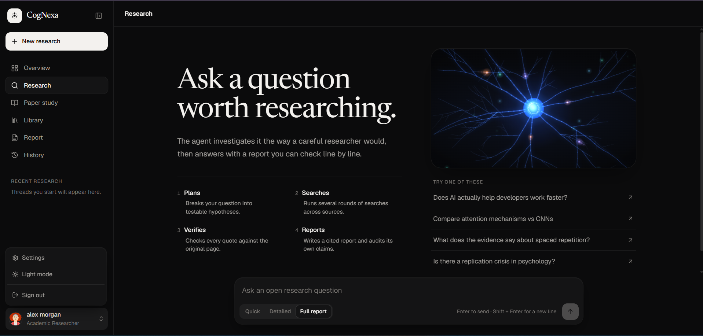
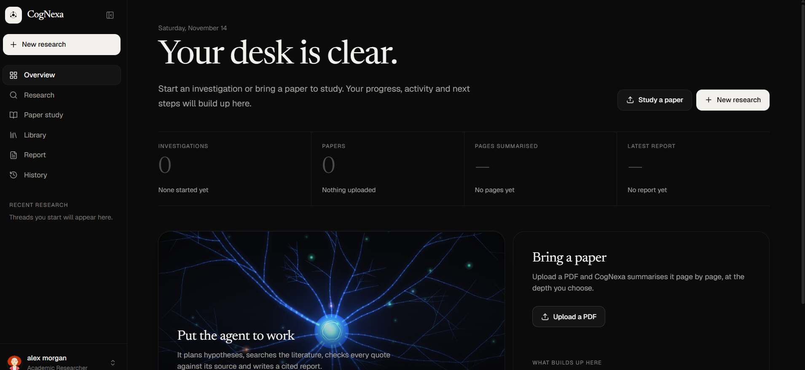
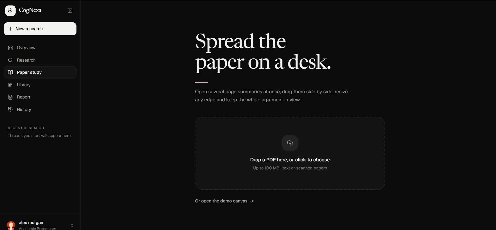

<div align="center">


# CogNexa

**A research workspace that investigates open questions, checks every quote against its source, writes up editable research papers, and helps you study academic PDFs.**

[Live demo](https://autonomous-research-agent-nu.vercel.app) · [Features](#features) · [How it works](#how-research-works) · [Getting started](#getting-started) · [API](#api-reference) · [Deployment](#deployment)


<br />



</div>

---

## Overview

Most AI answers can't be checked. CogNexa works the other way round: it researches a question the way a careful researcher would, and every claim in its answer points to a source it actually retrieved, with the quoted passage you can open and verify.

It has two workspaces:

- **Research.** Ask an open question and choose how much you need: a **Quick answer**, a **Detailed analysis**, or a **Research paper**: a structured academic document you can edit in CogNexa and download as a PDF.
- **Paper study.** Upload a PDF and read it with page-by-page explanations, an overview, flashcards, practice questions and highlights, plus an assistant that answers questions about the paper.

## Screenshots

<table>
  <tr>
    <td width="50%">
      
      <p align="center"><b>Overview</b><br /><sub>Progress, activity and next steps, built only from your real data</sub></p>
    </td>
    <td width="50%">
      
      <p align="center"><b>Paper study</b><br /><sub>Upload a PDF and study it page by page</sub></p>
    </td>
  </tr>
</table>

## Features

### Research
- **Three output modes that change the work, not just the length.**

  | Mode | Search | What you get |
  | --- | --- | --- |
  | Quick answer | 1 round | A direct answer, its key evidence and its caveats, with citations |
  | Detailed analysis | 2 rounds | An in-depth discussion: background, themes, findings, comparison of studies, conflicting evidence, implications, limitations and a synthesis |
  | Research paper | 3 rounds | A structured paper written section by section from the verified evidence, opened as an editable document |

- **Go further from any answer.** After a quick answer or a detailed analysis, one click researches the same question again in a deeper mode. Typed instructions such as "give detailed analysis" are recognised and handled the same way.
- **Working Flow.** While a run is in progress you see plain stages (understanding the question, discovering sources, gathering evidence, evaluating credibility, comparing findings, preparing the output), each pending, in progress or completed, with the run's real duration. The engine's internal reasoning, prompts and search queries are never shown.
- **Verified citations.** Evidence counts only when an exact sentence can be quoted from the source; quotes are checked against the original page and labelled verified, snippet-only or unverified. Citations open the source with the quoted passage highlighted.
- **Conversations.** Follow-up questions stay in the same conversation and are researched in its context.

### Research papers
- **A real document, not a long chat answer.** Title, abstract, keywords, introduction and objectives, methodology, literature review, thematic analysis, findings, comparative analysis, conflicting evidence, discussion, research gaps, limitations, conclusion and references, adapted to the topic.
- **References you can trust.** The reference list is built from the sources that run actually retrieved, never written by the model. Any citation that doesn't resolve to one of them is removed, and every claim is checked against its quoted source before the paper is saved.
- **Edit in CogNexa.** A page-style editor for the title, author, abstract, keywords and sections (add, remove, reorder), with a formatted preview, Ctrl/Cmd+S saving and a warning before leaving unsaved changes.
- **Versions.** Every save is a new version; the generated original is always kept as version 1, and a stale editor can't overwrite a newer save.
- **PDF export.** Cover page, abstract, numbered sections, references on a new page with clickable links, running header and page numbers. Each version's PDF is kept in private storage and can be downloaded again at any time.

### Paper study
- PDF upload up to 25 MB and 300 pages, with text extraction (PyMuPDF). Original PDFs are kept in private Supabase Storage.
- Page-by-page explanations at **Beginner**, **Medium** or **Pro** level, generated in the background, with progress over Server-Sent Events and per-page retry.
- A study kit generated automatically: overview, flashcards with progress tracking, practice questions and highlights, each linked back to the pages it came from.
- A reader with the original PDF beside the notes, and an assistant that answers questions about the paper.

### Workspace
- **History** is the archive of every research conversation, showing its modes, status, and whether a research paper exists or has been edited, with links to reopen the conversation, continue editing the paper or download its PDF. Uploaded papers are listed too.
- **Accounts:** email and password or Google sign-in, password reset by email, and short-lived access tokens with rotating refresh tokens. Every conversation, paper and file is private to its owner.
- Light and dark themes, a collapsible sidebar, and a responsive layout down to phone width.

## How research works

```mermaid
flowchart LR
    Q([Question + mode]) --> P[Plan<br/>testable propositions]
    P --> S[Search<br/>Tavily · 1–3 rounds by mode]
    S --> W[Weigh evidence<br/>supports · refutes · context]
    W -->|gaps remain| S
    W --> V[Verify quotes<br/>against source pages]
    V --> X[Review conflicts<br/>scope vs real contradiction]
    X --> A[Write for the mode<br/>answer · analysis · paper]
    A --> C[Audit<br/>citations · grounding · counter-evidence]
    C --> R([Result])
```



Internally, the engine breaks the question into testable propositions, searches for confirming and disconfirming evidence over several rounds, scores sources by type, verifies quotes, and has an independent reviewer decide whether conflicting evidence is a genuine contradiction or a difference in scope. The answer for the chosen mode is then written from that evidence and audited before it is shown. A run executes in the background; the page follows its progress and picks it up again after a reload.

## Tech stack

| Layer | Technology |
| --- | --- |
| Frontend | Next.js 14 (App Router), React 18, TypeScript |
| Styling | Tailwind CSS, Radix UI primitives, Lucide icons |
| Data and state | TanStack Query, Zustand |
| Backend | FastAPI, Uvicorn, Pydantic, SQLAlchemy |
| AI and search | Google Gemini (`google-genai`), Tavily search |
| Database | Supabase PostgreSQL (SQLite for local development), Alembic migrations |
| File storage | Supabase Storage, private bucket (original PDFs and research paper PDFs) |
| Documents | PyMuPDF for PDF text extraction and research paper PDF rendering |
| Hosting | Vercel (frontend), Render (backend) |

## Project structure

```
.
├── backend/
│   ├── app/
│   │   ├── main.py            # FastAPI app, CORS, original research routes
│   │   ├── research.py        # Research engine: planning, search rounds, evidence, verification, conflicts
│   │   ├── llm.py             # Gemini calls: planning, classification, report writing, self-critique
│   │   ├── research_api.py    # Research runs, Working Flow, threads, research papers and their PDFs
│   │   ├── research_paper.py  # Writers for the quick answer, detailed analysis and research paper
│   │   ├── research_pdf.py    # Research paper PDF rendering
│   │   ├── papers.py          # Paper upload, page explanations, original PDF download
│   │   ├── study.py           # Paper study kit: overview, flashcards, questions, highlights
│   │   ├── study_api.py       # Study kit routes and the paper assistant
│   │   ├── tasks.py           # Background workers for papers and study kits
│   │   ├── storage.py         # Private Supabase Storage
│   │   ├── auth/              # Accounts, Google sign-in, tokens, email
│   │   ├── models.py          # SQLAlchemy models
│   │   ├── database.py        # Engine and sessions
│   │   └── db_url.py          # Database URL, driver and TLS settings
│   ├── alembic/               # Database migrations
│   ├── tests/                 # pytest suite
│   └── requirements.txt
├── frontend/
│   ├── app/                   # Routes: dashboard, research, research/paper/[id], paper-study, library, history, settings, auth
│   ├── components/            # UI, research (Working Flow, paper editor), paper study, layout
│   ├── lib/                   # API client, queries, auth, research runs, paper formatting
│   └── tests/                 # node:test unit tests
├── docs/screenshots/
└── render.yaml                # Render deployment blueprint
```

## Getting started

### Prerequisites
- Node.js 18.17 or later
- Python 3.10 or later with `pip`
- A [Google Gemini API key](https://aistudio.google.com/apikey) and a [Tavily API key](https://tavily.com)
- Optional for local development, required in production: a [Supabase](https://supabase.com) project (PostgreSQL and a private Storage bucket)

### 1. Backend

```bash
cd backend
python -m venv venv
# Windows: venv\Scripts\activate    macOS/Linux: source venv/bin/activate
pip install -r requirements.txt
cp .env.example .env               # then fill in your keys, and FRONTEND_URL=http://localhost:3000
python -m alembic upgrade head     # create or update the database schema
uvicorn app.main:app --reload --port 8000
```

The API is now at `http://localhost:8000`. Without `DATABASE_URL`, it uses a local SQLite file (`backend/cognexa.db`). Without Supabase Storage settings, uploaded PDFs are kept in `backend/uploads` (development only).

### 2. Frontend

```bash
cd frontend
npm install
cp .env.local.example .env.local   # NEXT_PUBLIC_API_URL=http://localhost:8000
npm run dev
```

Open [http://localhost:3000](http://localhost:3000).

### 3. Tests

```bash
cd backend && python -m pytest tests -q     # backend: uses throwaway SQLite files and never calls the AI or the real bucket
cd frontend && npm test                     # frontend unit tests
cd frontend && npm run build                # production build with type checking
```

### Environment variables

**Backend (`backend/.env`)**

| Variable | Required | Description |
| --- | --- | --- |
| `GEMINI_API_KEY` | Yes | Google Gemini API key |
| `TAVILY_API_KEY` | Yes | Tavily search API key |
| `JWT_SECRET` | Yes in production | Signing key for access tokens; set a long random value so sign-ins survive restarts |
| `DATABASE_URL` | Yes in production | PostgreSQL URL (e.g. the Supabase session pooler); unset uses local SQLite |
| `DATABASE_DRIVER` | No | `psycopg` (default) or `pg8000` for PostgreSQL |
| `DATABASE_SSL_ROOT_CERT` | Recommended | Path to the database CA certificate, for verified TLS connections |
| `SUPABASE_URL` | Yes in production | Supabase project URL |
| `SUPABASE_SECRET_KEY` | Yes in production | Supabase secret key (server only, never sent to the browser) |
| `SUPABASE_STORAGE_BUCKET` | Yes in production | Private bucket for PDFs |
| `FRONTEND_URL` | Yes | The frontend's URL, used for sign-in redirects and CORS (`http://localhost:3000` locally) |
| `ALLOWED_ORIGINS` | No | Comma-separated extra CORS origins; defaults to local development ports |
| `GOOGLE_CLIENT_ID`, `GOOGLE_CLIENT_SECRET`, `OAUTH_REDIRECT_URI` | For Google sign-in | Google OAuth client |
| `SMTP_HOST`, `SMTP_PORT`, `SMTP_USERNAME`, `SMTP_PASSWORD`, `SMTP_FROM` | For password reset | Outgoing email |
| `APP_ENV` | No | Set to `production` in production (Render is detected automatically) |
| `GEMINI_MODEL` | No | Override the primary Gemini model; fallback models are tried automatically |
| `PAPER_MAX_MB`, `PAPER_MAX_PAGES` | No | Upload limits (default 25 MB, 300 pages) |
| `LLM_MOCK` | No | Set to `1` for UI development without calling the model |

In production, uploads are refused rather than stored on the server's disk if Supabase Storage is not configured, because Render's disk is wiped on restart.

**Frontend (`frontend/.env.local`)**

| Variable | Description |
| --- | --- |
| `NEXT_PUBLIC_API_URL` | Base URL of the backend API |

## API reference

All endpoints except `/health` and sign-in require `Authorization: Bearer <access token>`. Requests for another user's data return `404`.

**Research**

| Method | Endpoint | Description |
| --- | --- | --- |
| `POST` | `/research/runs` | Start a run in the background. Body: `{ "question", "output_format": "quick" \| "detailed" \| "full", "thread_id"? }`, or `{ "based_on": session_id, "output_format" }` to research an earlier question again in another mode |
| `GET` | `/research/runs/{id}` | Progress (Working Flow) and result of a run |
| `GET` | `/research/threads` | Conversations, with their modes, status and paper state (History) |
| `GET` | `/research/threads/{id}` | Every turn of a conversation |
| `POST` | `/research/sessions/{id}/paper` | Retry writing a research paper that failed |
| `GET` | `/research/documents/{id}` | A research paper (latest version, or `?version=n`) and its version list |
| `PUT` | `/research/documents/{id}` | Save edits as a new version. Body: `{ "content", "base_version" }` |
| `GET` | `/research/documents/{id}/pdf` | Download a version's PDF from private storage |
| `GET` | `/research/sessions` | List research sessions |
| `POST` | `/research` | Original synchronous research endpoint (kept for compatibility) |

**Papers and study**

| Method | Endpoint | Description |
| --- | --- | --- |
| `GET` / `POST` | `/papers` | List papers / upload a PDF (multipart: `file`, `level`) |
| `GET` / `PATCH` | `/papers/{id}` | Paper details / change the explanation level |
| `GET` | `/papers/{id}/file` | The original PDF (supports byte ranges) |
| `GET` | `/papers/{id}/pages`, `/outline`, `/status`, `/progress` | Page list, outline, status, and progress as Server-Sent Events |
| `GET` | `/papers/{id}/pages/{n}`, `/pages/{n}/text` | One page's explanation, or its extracted text |
| `POST` | `/papers/{id}/explain`, `/pages/{n}/regenerate`, `/retry-failed` | Start, redo or retry page explanations |
| `GET` / `POST` | `/papers/{id}/study` | The study kit's state / start it |
| `GET` | `/papers/{id}/study/{kind}` | Overview, flashcards, questions or highlights |
| `POST` | `/papers/{id}/ask` | Ask the assistant about the paper |

**Accounts**

| Method | Endpoint | Description |
| --- | --- | --- |
| `POST` | `/auth/register`, `/auth/login`, `/auth/refresh`, `/auth/logout` | Email sign-up, sign-in, token refresh, sign-out |
| `GET` / `PATCH` | `/auth/me` | The signed-in user |
| `POST` | `/auth/forgot-password`, `/auth/reset-password` | Password reset by email |
| `GET` | `/auth/google/login`, `/auth/google/callback` | Google sign-in |

## Deployment

- **Database and storage → Supabase.** Create a PostgreSQL database and a **private** Storage bucket (PDFs only). Apply the schema from your machine with `python -m alembic upgrade head` (with `DATABASE_URL` pointing at the database); migrations only add tables and columns and enable row level security, so only the backend can read the data.
- **Backend → Render.** `render.yaml` defines the web service (`uvicorn app.main:app`). Set the backend variables above in the Render dashboard, including `JWT_SECRET`, `DATABASE_URL`, the three `SUPABASE_*` settings and `FRONTEND_URL`. If you verify the database certificate, upload it as a Secret File and point `DATABASE_SSL_ROOT_CERT` at it.
- **Frontend → Vercel.** Import the repository with `frontend` as the root directory and set `NEXT_PUBLIC_API_URL` to the Render service URL.

> On Render's free tier the service sleeps when idle. Research runs execute inside the backend process, so a run that is in progress when the service restarts is reported as interrupted and can be asked again.

## Authors

- **[Stuti Thakker](https://github.com/thakkerstuti)**
- **Vanshika Sultania**
